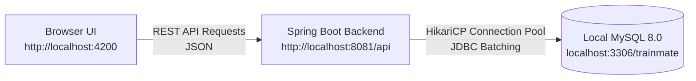

# TrainMate &bull; Cohort & Trainer Automatic Allocation System

[](https://www.cognizant.com)
[](https://angular.dev)
[](https://spring.io)
[](https://www.mysql.com)
[](https://poi.apache.org)

TrainMate is a full-stack enterprise web application engineered to streamline the management of technical training cohorts and automate trainer allocations within **Cognizant Academy**.

---

## 1. Project Overview

In corporate academy environments, coaches manage numerous training batches ("cohorts") that require qualified trainers with matching skills, availability, and balanced workloads. 

**TrainMate solves this by providing:**
1. **Direct Cohort Creation & Excel Upload**: Coaches can either create cohorts on-the-fly using a modern form or batch-upload cohorts via an Excel file (`.xlsx`).
2. **Deterministic 100-Point Allocation Engine**: Automatically evaluates trainers and assigns the best candidate based on 5 weighted criteria:
   - **Skill Match (40 pts)**: Proportional match against required technologies
   - **Availability (20 pts)**: Verified date coverage across batch dates
   - **Current Workload (15 pts)**: Headroom under maximum workload capacity
   - **Experience (15 pts)**: Seniority and years of industry training experience
   - **Cohort Delivery Track Record (10 pts)**: Reliability and past performance
3. **Admin Reassignment**: Admins have global visibility, workload balancing controls, and one-click trainer reassignment.
4. **Internal Mailbox**: Instant automated messaging notifying coaches and trainers of batch assignments.
5. **Full Offline Support**: The entire application (Frontend, Backend, and Database) can run 100% locally with zero external internet dependencies.

---

## 2. Database Architecture (4 Core Tables)

The database strictly follows a clean 4-table relational ER schema in MySQL (`trainmate`):

```
+----------------+          +------------------------+
|     USERS      |          |        TRAINER         |
+----------------+          +------------------------+
| user_id (PK)   |<---+     | trainer_id (PK)        |
| name           |    +-----| user_id (FK)           |
| email          |          | skill_set              |
| password       |          | experience_years       |
| role           |          | available_from         |
| created_date   |          | available_till         |
+----------------+          | current_workload       |
        ^                   | max_workload           |
        |                   +------------------------+
        |                               ^
        |                               |
+-------+-------------------------------+------------+
|                       COHORT                       |
+----------------------------------------------------+
| cohort_id (PK)                                     |
| cohort_code                                        |
| service_line, stream, required_skill, location     |
| trainee_count, start_date, end_date                |
| coach_user_id (FK -> users.user_id)                |
| assigned_trainer_id (FK -> trainer.trainer_id)     |
| status (ASSIGNED, UNASSIGNED, ACTIVE, COMPLETED)   |
| created_date                                       |
+----------------------------------------------------+
        ^
        |
+-------+--------------------------------------------+
|                    NOTIFICATION (MAIL)             |
+----------------------------------------------------+
| notification_id (PK)                               |
| cohort_id (FK -> cohort.cohort_id)                 |
| receiver_user_id (FK -> users.user_id)             |
| notification_type                                  |
| message                                            |
| created_date                                       |
+----------------------------------------------------+
```

---

## 3. Technology Stack

- **Frontend**: Angular 19 (Standalone Components, RxJS 7, Plus Jakarta Sans & Inter typography, Bootstrap 5, Bootstrap Icons, responsive mobile drawer)
- **Backend**: Spring Boot 3.3.5 (Java 21, Spring Web MVC, Spring Data JPA, Hibernate, HikariCP, Flyway, Bean Validation)
- **Database**: MySQL 8.0 (`localhost:3306`)
- **Excel Processing**: Apache POI 5.2.5 (`poi-ooxml`)
- **Testing**: JUnit 5, Mockito (100% pass rate)

---

## 4. How to Run 100% Offline (Local Development)

TrainMate is architected to run completely standalone on your local machine or company laptop inside corporate firewalls without requiring an internet connection or cloud services.

### Offline Architecture Overview



---

### Prerequisites
Make sure the following tools are installed on your machine:
* **Java JDK 21+** (`java -version`)
* **Node.js v18+ or v20+** (`node -v` and `npm -v`)
* **MySQL Server 8.0+** OR **Docker Desktop**
* **Apache Maven 3.9+** (optional, you can also use `./mvnw`)

---

### Step 1: Start the Local MySQL Database & Create Database

You can run MySQL either natively or via Docker. Choose whichever option you prefer:

#### Option A: Native Local MySQL (Installed on Windows / Mac / Linux)
1. Start your local MySQL service (e.g., via Windows Services or MySQL Workbench).
2. Open your terminal or MySQL Command Line Client:
   ```bash
   mysql -u root -p
   ```
   *(Enter your MySQL password when prompted, default is `123456`).*
3. Create the database with one SQL command:
   ```sql
   CREATE DATABASE IF NOT EXISTS trainmate;
   ```
4. Verify it was created:
   ```sql
   SHOW DATABASES;
   EXIT;
   ```
   *(Or in **MySQL Workbench**, click the "Create a new schema in the connected server" icon, name it `trainmate`, and click **Apply**).*

5. Ensure your credentials in `backend/trainmate-backend/src/main/resources/application-local.properties` match:
   - **Default user:** `root`
   - **Default password:** `123456`
   *(If your local MySQL root password is different, change `spring.datasource.password` in that file).*

#### Option B: Docker MySQL (One Command - Easiest)
If you have Docker Desktop running, you can start MySQL and create the database in a single command without installing MySQL locally:
```bash
docker run --name trainmate-mysql -e MYSQL_ROOT_PASSWORD=123456 -e MYSQL_DATABASE=trainmate -p 3306:3306 -d mysql:8.0
```

> [!NOTE]  
> **Automatic Schema & Data Migration:** When Spring Boot starts up locally, **Flyway** automatically runs and builds all 4 tables (`users`, `trainer`, `cohort`, `notification`) and automatically seeds all initial demo data. You do **not** need to manually run table creation scripts!  
> *(If you ever want to reset the database manually from scratch, you can run `SOURCE database/schema.sql;` followed by `SOURCE database/data.sql;` inside MySQL).*

---

### Step 2: Start the Backend (Spring Boot)

1. Open a new terminal and navigate to the backend directory:
   ```bash
   cd backend/trainmate-backend
   ```
2. Run the application with the `local` profile:
   ```bash
   mvn spring-boot:run
   ```
   *Or explicitly specify the profile:*
   ```bash
   mvn spring-boot:run -Dspring-boot.run.profiles=local
   ```
3. **Verify the backend is running:**  
   Open your browser or run curl:
   ```bash
   curl http://localhost:8081/api/health
   ```
   You should see:
   ```json
   {"success":true,"message":"TrainMate backend process is alive","data":{"status":"UP","version":"1.0.0"}}
   ```

*The local backend listens on port **`8081`**.*

---

### Step 3: Start the Frontend (Angular)

1. Open a second terminal and navigate to the frontend directory:
   ```bash
   cd frontend/trainmate-ui
   ```
2. Install dependencies (only required the first time):
   ```bash
   npm install
   ```
3. Start the Angular development server:
   ```bash
   npm start
   ```
   *(This executes `ng serve --port 4200` with the `development` configuration).*
4. Open your browser and navigate to:
   ```text
   http://localhost:4200
   ```

> [!TIP]  
> **How Angular knows where to connect:** In `frontend/trainmate-ui/src/environments/environment.development.ts`, the API URL is set to `http://localhost:8081/api`. When you run `npm start`, Angular automatically swaps to this local configuration.

---

## 5. Demo Login Credentials (Offline)

You can click any of the **1-click quick login buttons** on the login screen, or manually enter:

| Role | Username / Email | Password | Access & Responsibilities |
| :--- | :--- | :--- | :--- |
| **Coach** | `coach01` | `password123` | Create batches, upload Excel schedules, inspect allocation scores |
| **Trainer** | `trainer01` | `password123` | View assigned cohorts, training calendar, incoming notifications |
| **Admin** | `admin01` | `password123` | Master view, trainer capacity overview, manual reassignment, export reports |

---

## 6. Offline Testing & Verification

To verify the test suite offline without starting any external services:

```bash
# Run backend JUnit 5 & Mockito tests (24 tests)
cd backend/trainmate-backend
mvn test

# Run frontend production build
cd frontend/trainmate-ui
npm run build
```

---

## 7. Troubleshooting & FAQ (Offline Mode)

### Q: Port 8081 is already in use
If another application is using port `8081`, open `backend/trainmate-backend/src/main/resources/application-local.properties` and change:
```properties
server.port=8082
```
Then update `frontend/trainmate-ui/src/environments/environment.development.ts`:
```typescript
export const environment = {
  production: false,
  apiUrl: 'http://localhost:8082/api'
};
```

### Q: My MySQL password is not `123456`
Open `backend/trainmate-backend/src/main/resources/application-local.properties` and update your credentials:
```properties
spring.datasource.username=YOUR_MYSQL_USERNAME
spring.datasource.password=YOUR_MYSQL_PASSWORD
```

### Q: How do I switch between Local Offline Mode and Cloud Mode?
- **For Offline Local:** Run `npm start` in the frontend directory. Angular uses `environment.development.ts` pointing to `http://localhost:8081/api`.
- **For Production Cloud:** Running `ng build --configuration production` compiles Angular using `environment.ts` pointing to your cloud Render deployment `https://trainmate-o6tv.onrender.com/api`.

### Q: Does pushing to GitHub automatically deploy to Render?
**Yes!** Render is connected directly to your GitHub repository (`aryan25798/TrainMate`) on the `main` branch. Every time you push a commit:
1. GitHub fires a webhook event to Render.
2. Render automatically triggers a new deployment build.
3. The latest changes go live automatically at `https://trainmate-o6tv.onrender.com` within 2–3 minutes with zero manual intervention required.

---

## 8. Architectural Highlights

1. **Deterministic 100-Point Allocation Matrix:** Algorithm evaluates skill overlap, date window coverage, workload headroom, years of experience, and past cohort delivery track record without external dependencies.
2. **In-Flight Deduplication & Memory Cache:** Angular `HttpCacheService` uses `shareReplay` to prevent duplicate database reads during rapid page navigation.
3. **Fast Batch Ingestion:** Batch duplicate cohort checking in O(1) via `findExistingCohortCodes`, handling bulk Excel uploads smoothly.
4. **Resilient Cloud Health Probes:** Dual-tier probes (`/api/health` for zero-IO liveness, `/api/health/ready` for database readiness) maintain uptime on cloud hosts like Render.
